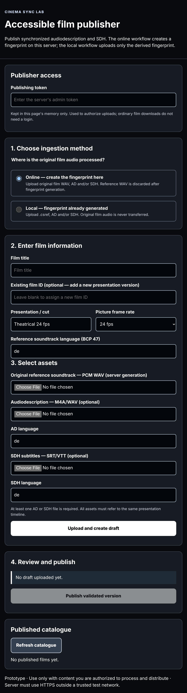

# Getting started

This walks through a full local test: run the catalogue server, publish a film package, and
play it back on an Android phone.



## 1. Start the catalogue server

You need Python 3.12 or newer. The server refuses to start without an admin token of at least
16 characters.

On Windows, in PowerShell:

```powershell
$env:INKINO_ADMIN_TOKEN = "replace-with-a-long-random-secret"
cd server
.\START_WINDOWS.bat
```

The script creates a virtual environment, installs the dependencies, and serves on port 8765
on all network interfaces, so a phone on the same Wi-Fi can reach it. Allow only trusted
devices through the firewall. Use `START_LOCALHOST.bat` instead if you don't need phone access.

On Linux or macOS:

```sh
cd server
python -m venv .venv && . .venv/bin/activate
pip install -r requirements.txt
INKINO_ADMIN_TOKEN=replace-with-a-long-random-secret uvicorn app:app --host 127.0.0.1 --port 8765
```

Data is stored in `server-data/` (override with `INKINO_DATA_DIR`).

Over plain HTTP, the admin token travels unencrypted. Keep the publisher (browser or desktop
app) on `localhost`, and let the phone use only the public catalogue endpoints. See
[SECURITY.md](../SECURITY.md).

## 2. Publish a film package

There are two ways to publish. Both produce the same package format.

### Web publisher (fingerprint created on the server)

1. Open <http://localhost:8765> and enter the admin token.
2. Choose **Online**, then enter the title, presentation label, frame rate, and language.
3. Select the reference soundtrack (PCM WAV), plus an AD track (M4A/WAV), an SDH file
   (SRT/VTT), or both.
4. Click **Upload and create draft**. Long soundtracks take a while to fingerprint.
5. Check the assigned IDs, then click **Publish validated version**.

The reference WAV is deleted after fingerprinting and is never stored as a catalogue asset.

### Desktop publisher (fingerprint created locally)

```powershell
cd desktop-publisher
.\START_WINDOWS.bat
```

Set the server to `http://127.0.0.1:8765`, enter the token, choose the files, and select
**Generate locally and upload**. The reference soundtrack is only read by the local
fingerprint generator and is never uploaded. There is also a CLI:
`python desktop-publisher/publish.py --help`.

### Test material

The Elephants Dream demo package is a complete, real example: the film's soundtrack, a
recorded audio description, and subtitles, all under Creative Commons licenses. Build it with
`demo/elephants-dream/build.py` (see [its README](../demo/elephants-dream/README.md)), then
either serve the generated catalogue directly or publish its files to your own server. To
give the phone something to match, play the film from a computer.

## 3. Build and run the Android app

1. Open `android/` in Android Studio with JDK 17 and Android SDK 36.
2. Build and install the debug variant.
3. Put the phone and computer on the same Wi-Fi and find the computer's IP address
   (`ipconfig` on Windows).
4. In the app, open **Menu → Settings** and set the catalogue server address to
   `http://<computer-ip>:8765`.
5. Open **Online Catalogue**, download a film, and it will appear under **My Films**.
6. Turn off networking if you like, open the film, start synchronization, and play the
   reference soundtrack. AD needs confirmed headphones. SDH works without.

Plain HTTP is only allowed in debug builds. Release builds require HTTPS.

The **Manual Player** lets you load a `.csref`, AD, and SDH file directly, without a server.
